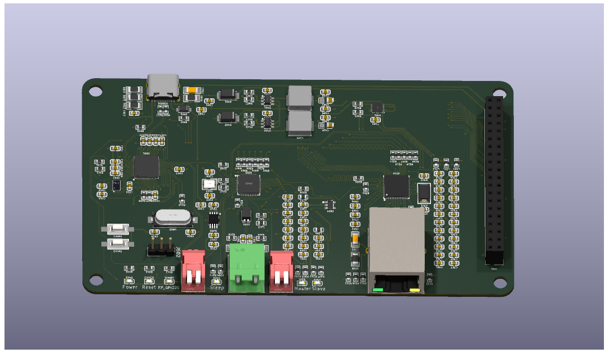
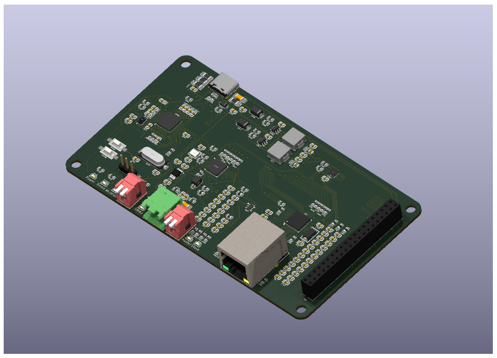

# 1000BASE-T1 converter

1000BASE-Tと1000BASE-T1を相互変換する、学習・評価用メディアコンバーターです。
1000BASE-T側にTexas Instruments DP83867、1000BASE-T1側にDP83TG720を使用し、
RP2040からMDIO経由でPHYの設定と状態確認を行います。

Ethernetフレームは2個のPHY間をRGMIIで転送されます。RP2040はPHY管理を担当し、
フレームをソフトウェア転送しません。

> [!WARNING]
> 開発中のハードウェアです。車載、安全、生命維持など、故障が人身・財産へ影響する
> 用途を想定していません。製造データは状態表示と注意事項を確認して使用してください。

## 特徴

- 1000BASE-T（RJ45）と1000BASE-T1（シングルペア）のメディア変換
- RP2040によるClause 22／MMDレジスターアクセスに対応
- USB CDC経由でPHY検出、状態確認、レジスター読み書きが可能
- DP83867のRGMII TX/RX内部遅延を起動時に設定
- T1 PHYのmaster／slaveをファームウェアで選択可能

## 基板

基板イメージは参考です。改良により実際の設計と異なる場合があります。

## リポジトリ構成

| パス | 内容 |
| --- | --- |
| [`hardware/`](hardware/) | KiCad 9の回路図、階層シート、PCB |
| [`production/`](production/) | Gerber、ドリル、BOM、実装位置などの製造候補 |
| [`docs/`](docs/) | 基板画像と公開資料 |

主要な設計判断と検証方針は
[`docs/design-decisions/`](docs/design-decisions/)に記録しています。

## ファームウェア

RP2040用ファームウェア、ビルド方法、USB CDCコマンドは、独立した
[`TLDSJPWORK/1000base-t1-converter-soft`](https://github.com/TLDSJPWORK/1000base-t1-converter-soft)
リポジトリで公開します。

## 確認済み構成

2026-09-14に2台を `Mac ↔ converter ↔ converter ↔ Raspberry Pi` と接続し、
1000BASE-T full-duplex、両T1 PHYリンク、ARP、20回のping（損失0%）、
SSHポート到達を確認しています。確認内容と制約は
ソフトウェアリポジトリの
[`docs/validation.md`](https://github.com/TLDSJPWORK/1000base-t1-converter-soft/blob/main/docs/validation.md)
に記録しています。

## 製造データ

`production/rev-candidate-20261003/` はレビュー用の候補であり、現時点では発注禁止です。
未解決事項は同ディレクトリのREADMEを参照してください。旧データとの取り違えを防ぐため、
公開用リポジトリには現行候補だけを収録しています。

## 資料

- [回路図（PDF）](docs/1000base-t1-converter_schematic.pdf)
- [RP2040ファームウェア](https://github.com/TLDSJPWORK/1000base-t1-converter-soft)
- [設計上の意思決定](docs/design-decisions/)
- [100BASE-T1版](https://github.com/TLDSJPWORK/100base-t1-converter)

## ライセンス

ハードウェア設計、製造データ、文書、画像は
[Creative Commons Attribution 4.0 International](LICENSE)で提供します。
