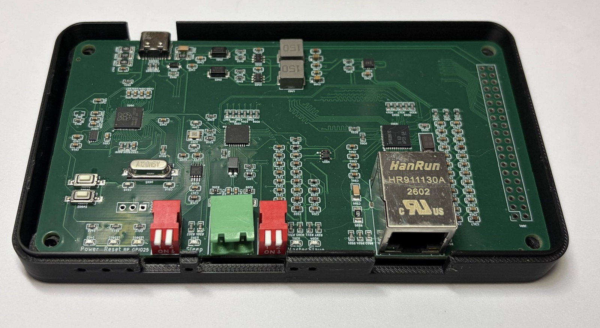
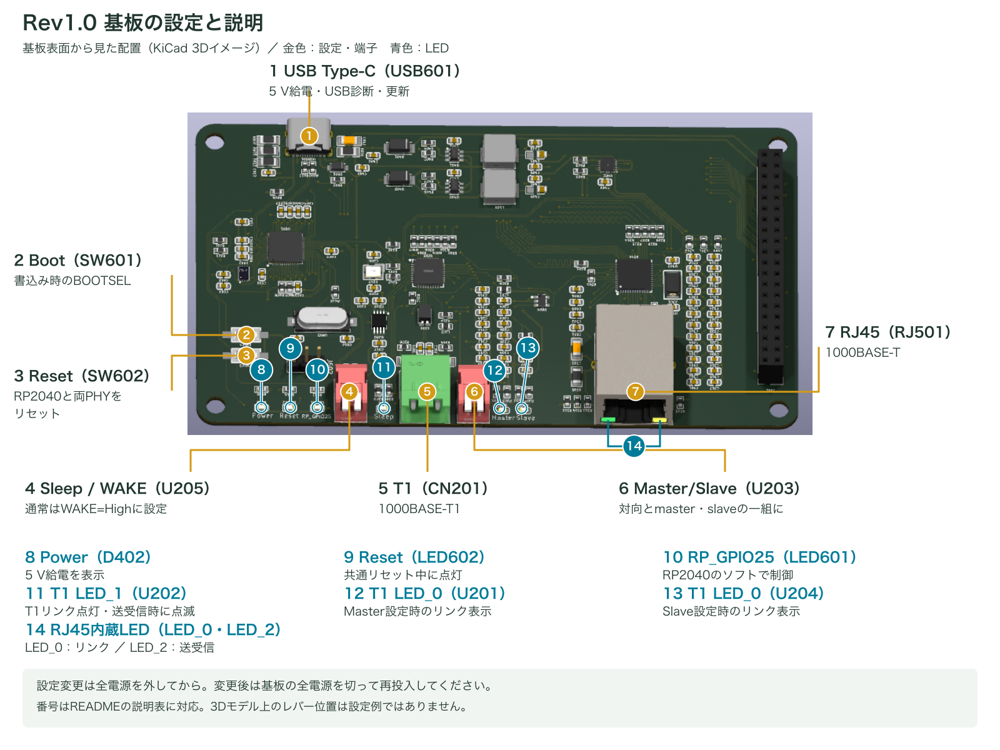
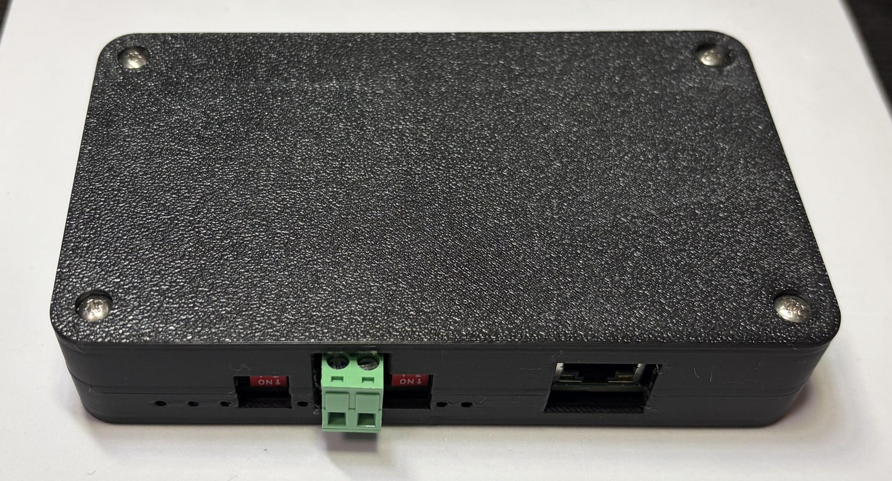
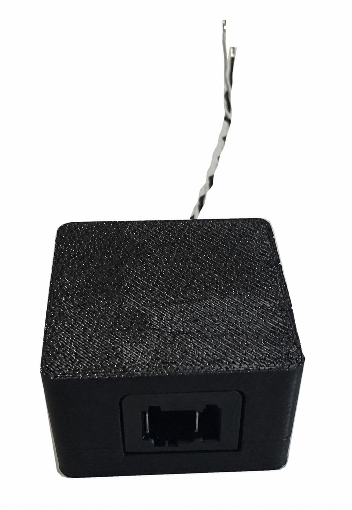

# 1000base-t1-converter for Education

学習用 1000BASE-T1 Media Converter

## 特徴

- Texas Instruments社のDP83TG720とDP83867を使用した、1000BASE-T1 ↔ 1000BASE-T（RJ45）のメディアコンバーターです。
- RP2040を搭載し、USB接続で各PHY ICの状態確認とレジスタ設定ができます。MDIOを通してPHY層の動きを学習できます。
- 基板上のスイッチで1000BASE-T1のmaster／slaveを選択できます。
- Ethernetフレームは2個のPHY間をRGMIIで転送し、RP2040はPHYの設定・状態確認を担当します。
- KiCadの回路図・PCB、製造データ、ケースのSTL・STEPを公開しています。

## 基板

収録している回路・基板はRev1.0です。基板外形は125 × 70 mmです。
基板イメージは参考であり、改良により実物と異なる場合があります。

## 基板の設定と説明

| 図の番号 | 接続部 | 使い方 |
| --- | --- | --- |
| 1 | USB Type-C（USB601） | 5 V給電、USB診断、ファームウェア更新に使用します。 |
| 2 | Boot（SW601） | ファームウェア書込み時のBOOTSELボタンです。 |
| 3 | Reset（SW602） | RP2040と両PHY（DP83TG720・DP83867）をリセットします。master／slave変更後は全電源を再投入してください。 |
| 4 | Sleep / WAKE（U205） | 通常の通信ではWAKEをHighに設定します。接点状態は下表を参照してください。 |
| 5 | T1（CN201） | 1000BASE-T1を接続します。pin 1=T1_P、pin 2=T1_Nです。 |
| 6 | Master/Slave（U203） | 対向機器と、一方をmaster、もう一方をslaveに設定します。 |
| 7 | RJ45（RJ501） | 1000BASE-T対応機器を接続します。 |

### スイッチの接点設定

U203・U205はそれぞれ2回路のスイッチです。ONは接続、OFFは開放を示します。
図中の3Dモデルのレバー位置は設定例ではありません。スイッチ本体のON表示と端子番号を確認してください。

| スイッチ | 設定 | 1–4の接点 | 2–3の接点 |
| --- | --- | --- | --- |
| Master/Slave（U203） | **master** | **ON** | **OFF** |
| Master/Slave（U203） | **slave** | **OFF** | **ON** |
| Sleep / WAKE（U205） | **通常動作（WAKE=High）** | **ON** | **OFF** |
| Sleep / WAKE（U205） | Sleep要求（WAKE=Low） | **OFF** | **ON** |

**両回路を同時にONにしないでください。** 上表の組合せで、一方をON、もう一方をOFFにしてください。
Sleepへの移行はPHYの設定やリンク状態にも依存します。
設定変更は全電源を外して行い、変更後は基板の全電源を再投入してください。
詳しい接続手順と給電方法は[取扱説明書](docs/user-manual.md)を参照してください。

### LEDの説明

上の「基板の設定と説明」図の青い番号8〜14が、下表に対応します。14はRJ45内蔵の2個のLEDをまとめて示しています。

Power・Reset・RP_GPIO25は、基板手前のシルク表示で識別できます。
T1側にはSleepスイッチ付近のU202と、Master/Slaveスイッチ付近のU201・U204があります。

| 図の番号 | 表示・位置 | 部品 | 説明 |
| --- | --- | --- | --- |
| 8 | Power | D402（緑） | 基板の5 V電源に接続された給電表示です。 |
| 9 | Reset | LED602（赤） | RP2040と両PHY（DP83TG720・DP83867）の共通リセット表示です。共通リセット信号がLowの間に点灯し、Resetボタン操作時にも点灯します。 |
| 10 | RP_GPIO25 | LED601（緑） | RP2040のGPIO25で制御するLEDです。点灯・点滅の意味はファームウェアに依存します。 |
| 11 | T1側・Sleepスイッチ付近 | U202（緑） | DP83TG720のLED_1出力に接続しています。リンク成立で点灯し、送受信時に点滅します。 |
| 12 | T1側・Master/Slaveスイッチ付近 | U201（緑） | **Master設定時のリンク表示**です。DP83TG720のLED_0出力を表示します。 |
| 13 | T1側・Master/Slaveスイッチ付近 | U204（緑） | **Slave設定時のリンク表示**です。DP83TG720のLED_0出力を表示します。 |
| 14 | RJ45内蔵LED | RJ501・LED_0側 | DP83867のリンク表示です。 |
| 14 | RJ45内蔵LED | RJ501・LED_2側 | DP83867の送受信アクティビティ表示です。 |

PHY関連のLED表示は、レジスタ設定によって変更できます。
LED出力の仕様はTIの[DP83TG720R-Q1データシート（IO_MUX_CFG_1）](https://www.ti.com/lit/ds/symlink/dp83tg720r-q1.pdf)と
[DP83867IR/CRデータシート（LED Interface）](https://www.ti.com/lit/ds/symlink/dp83867ir.pdf)を参照してください。

## 使用例

### メディアコンバーターとして使う

RP2040に[専用ファームウェア](https://github.com/TLDSJPWORK/1000base-t1-converter-soft)を書き込み、
T1側のmaster／slaveを設定して、1000BASE-T1機器とRJ45側の1000BASE-T機器を接続します。
ファームウェアが起動時にPHYの通信設定を適用します。

2台を `Mac ↔ converter ↔ converter ↔ Raspberry Pi` と接続し、
1000BASE-T full-duplex、両T1 PHYのリンク、ARP、20回のping（損失0%）、SSHポート到達を確認しています。
詳しい試験条件と確認範囲は[検証記録](https://github.com/TLDSJPWORK/1000base-t1-converter-soft/blob/main/docs/validation.md)を参照してください。

### PHYの動きを確認する

USB CDCシリアルから、PHYの検出、リンク状態の確認、レジスタの読み書きができます。
コマンドと使用方法は[取扱説明書のUSB診断](docs/user-manual.md#4-usb診断)と
[ファームウェアのREADME](https://github.com/TLDSJPWORK/1000base-t1-converter-soft)を参照してください。

## ケースと完成品の構成

[PLAケース](case/)の設計外形は132.8 × 77.8 × 28.0 mmです。上下ケースのSTL・STEPを収録しています。

ケース組立例。手前にT1端子、設定スイッチ、RJ45端子が並びます。

ケース入り完成品には、MATEnetアダプタ（ツイストペア線接続・ケース付き）が付属します。アダプタの[基板設計・製造・ケースデータ](adapter/)も収録しています。

付属MATEnetアダプタの外観。本体側プラグの取付前の状態です。

## 製造データ

[Rev1.0の製造データ](production/)には、基板製作に使用したGerber ZIP・BOM・実装位置データを収録しています。
対応するKiCadソースは[hardware/](hardware/)に収録しています。

再製造する場合は、部品指定や未実装部品についての[Rev1.0の既知事項](docs/rev1.0-known-issues.md)を確認してください。

## 資料

- [取扱説明書](docs/user-manual.md)
- [回路図（PDF）](docs/1000base-t1-converter_schematic.pdf)
- [KiCad回路図・PCB](hardware/)
- [Gerber・BOM・実装位置](production/)
- [ケースのSTL・STEP](case/)
- [RP2040ファームウェア・レジスタ読み書きソフト](https://github.com/TLDSJPWORK/1000base-t1-converter-soft)
- [学習用100BASE-T1メディアコンバーター](https://github.com/TLDSJPWORK/100base-t1-converter)

## 販売・問い合わせ

スイッチサイエンス様での委託販売を予定しています。

- 販売ページ：【発売後掲載】
- 技術問い合わせ先：tldsjpwork@gmail.com

## 関連プロジェクト

- [100base-t1-converter](https://github.com/TLDSJPWORK/100base-t1-converter)：100 Mbpsの100BASE-T1に対応した学習用メディアコンバーターです。
- [1000base-t1-converter-soft](https://github.com/TLDSJPWORK/1000base-t1-converter-soft)：本基板のRP2040用ファームウェアです。PHYの初期設定、状態確認、レジスタの読み書きに使用します。

## ライセンス

ハードウェア設計、製造データ、文書、画像は[Creative Commons Attribution 4.0 International](LICENSE)で公開します。
